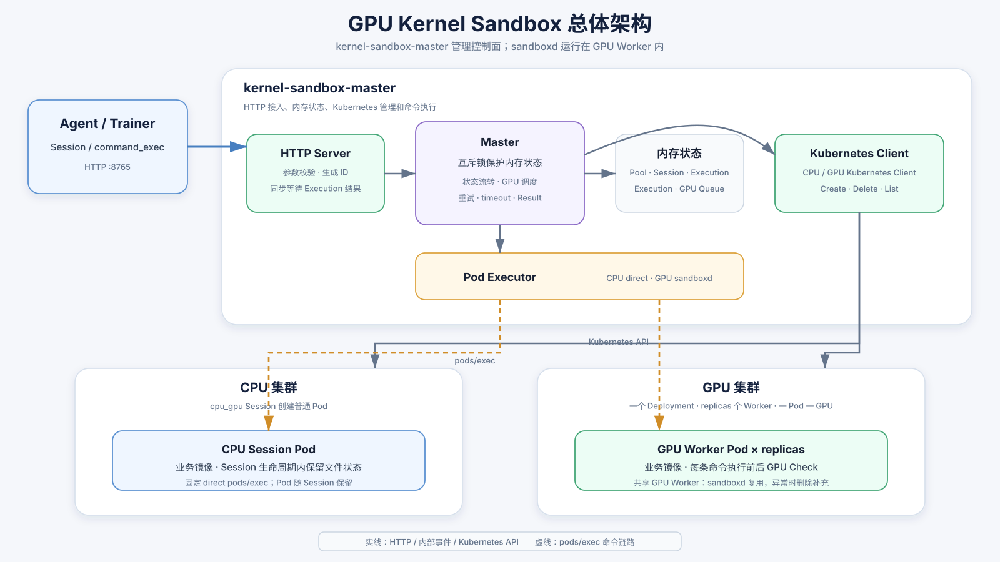
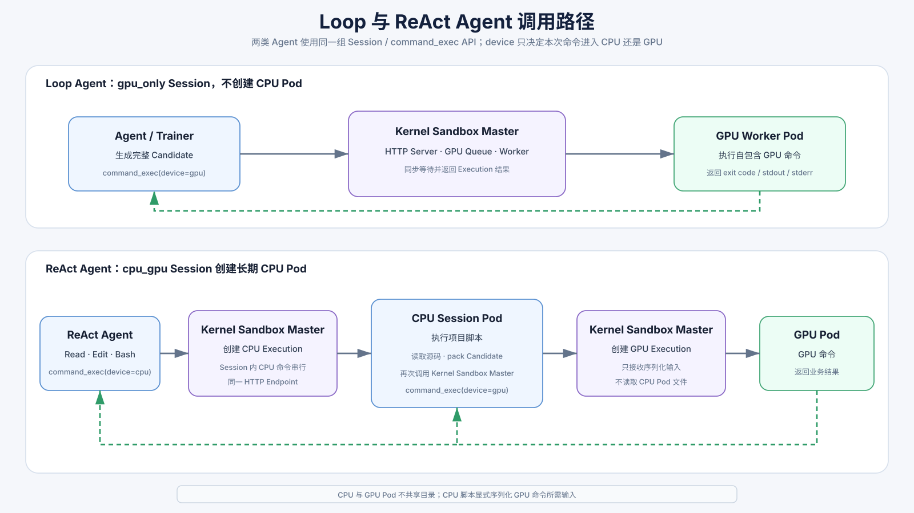
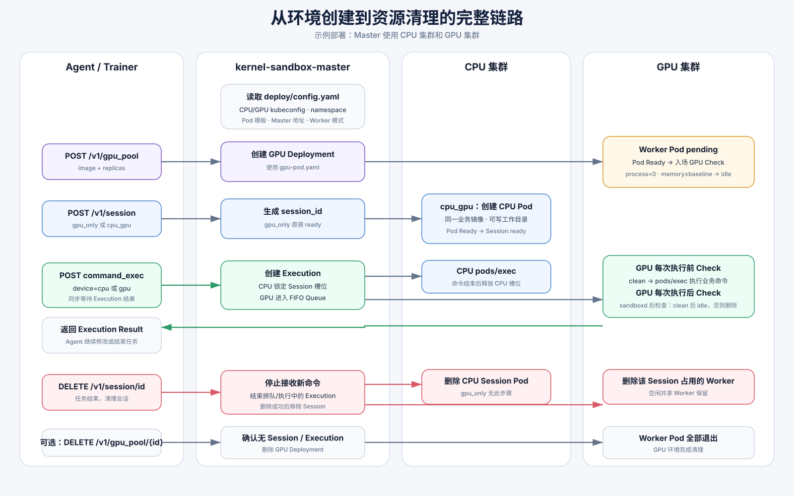
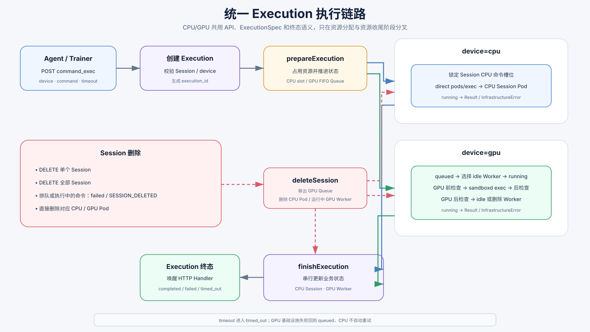
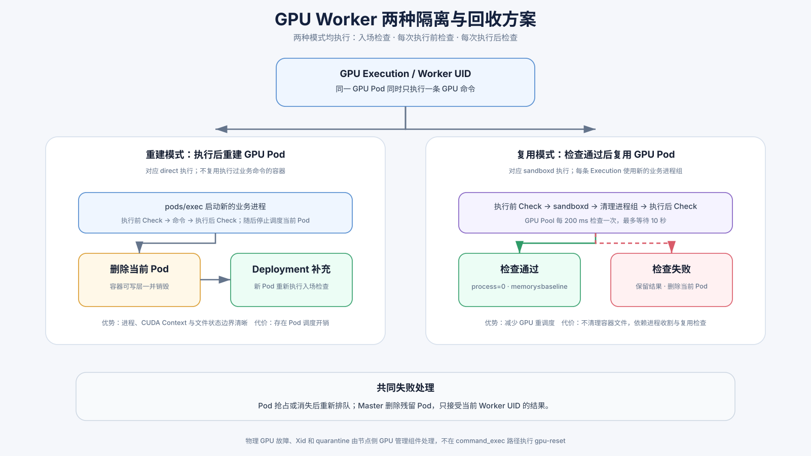

# 1. 背景

## 1.1 目标

GPU Kernel 训练需要两类执行环境：

- Loop Agent 在外部生成 Candidate，只执行 GPU 命令；
- ReAct Agent 在长期 CPU 环境中修改代码，并通过业务脚本按需执行 GPU 命令。

Kernel Sandbox 统一提供 GPU Pool、Session 和命令执行能力。Sandbox 不理解 bench、profile、sanitize 等业务语义，这些逻辑由训练框架、Agent 和业务镜像实现。

## 1.2 设计边界

- CPU Session Pod 运行在稳定 CPU 集群，共享 GPU Worker 和 gpu_only 独占 Pod 运行在 BE GPU 集群；
- CPU 与 GPU Pod 使用同一个业务镜像，但不共享文件系统；
- 一个 GPU Worker 同一时刻只执行一条命令；
- CPU 命令不自动重试，GPU 仅对基础设施失败重试；
- Master 使用内存状态，但会根据 Kubernetes Deployment/Pod 恢复 GPU Pool、CPU Session 和 gpu_only Session；Execution 不恢复；
- command_exec 是同步 HTTP 接口，不提供 Cancel、SDK 或跨 Pod gRPC。

# 2. 总体设计

## 2.1 总体架构



| 组件 | 职责 |
| --- | --- |
| Kernel Sandbox Master | 提供 HTTP API，维护 Session、Execution、GPU 队列和 Worker 状态 |
| Kubernetes Client | 访问 CPU/GPU 集群，创建、查询和删除 Pod、Deployment，并执行 pods/exec |
| CPU Session Pod | 在 Session 生命周期内串行执行 CPU 命令并保留文件状态 |
| GPU Worker Pod | 独占一张 GPU，串行执行 GPU 命令 |
| GPU Session Pod | gpu_only Session 独占的长期 GPU Pod，命令直接在其中执行 |
| sandboxd | 监督 GPU 业务进程并提供本地 GPU 状态 |

Master 通过独立 kubeconfig 访问 CPU、默认 GPU 和可选的模型 GPU 集群，不要求 Pod 暴露网络端口。业务可以创建多个 GPU Pool；cpu_gpu Session 绑定一个 Pool，gpu_only Session 根据 requests 中的资源名选择 GPU 集群。

## 2.2 Agent 调用路径



| Agent | 调用顺序 |
| --- | --- |
| Loop Agent | 创建 gpu_only Session → 生成 Candidate → 执行 GPU 命令 → 删除 Session |
| ReAct Agent | 创建 cpu_gpu Session → 执行 CPU 命令修改代码 → 业务脚本序列化 Candidate 并执行 GPU 命令 → 删除 Session |

CPU Pod 不直接访问 GPU Pod。需要 GPU 时，CPU Pod 内的业务脚本调用 command_exec(device=gpu)，通过 stdin 或业务存储传递 Candidate。

# 3. 详细设计

## 3.1 Master 与 API

### 3.1.1 组件和状态

系统包含两个二进制：

| 二进制 | 运行位置 | 职责 |
| --- | --- | --- |
| kernel-sandbox-master | 独立进程 | HTTP 接入、内存状态、Kubernetes 资源管理和 GPU 调度 |
| sandboxd | GPU Worker Pod | 单命令执行、超时处理、进程组清理和 GPU 状态查询 |

Master 是业务状态的唯一写入者。Kubernetes 操作和命令执行可以并行运行，但不会在持有状态锁时调用 Kubernetes。

| 对象 | 核心信息 | 状态 |
| --- | --- | --- |
| GPU Pool | gpu_pool_id、image、replicas、独立命令队列 | 存在或不存在 |
| Session | session_id、类型、GPU Pool、CPU/GPU Pod、当前 Execution | creating、ready、failed、deleting |
| Execution | 请求、gpu_pool_id、结果、当前 Worker UID、重试次数、排队截止时间 | queued、running、completed、failed、timed_out |
| GPU Worker | gpu_pool_id、Pod UID、当前 Execution | pending、idle、busy |

Execution 记录当前 Worker UID。Worker 丢失或 Execution 重试后，旧 Worker 的迟到结果因 UID 不匹配而被忽略。

completed 表示执行后端取得了 exit_code，包括 126、127 在内的非零退出码仍然是 completed。failed 表示命令未能按正常进程结果结束，例如执行后端明确报告进程启动失败、输出超限或基础设施重试耗尽；系统不会根据 126、127 推断启动失败。

### 3.1.2 公共 API

| 接口 | 返回 | 语义 |
| --- | --- | --- |
| POST /v1/gpu_pool | 202 | 创建 GPU Pool 并动态生成 gpu_pool_id，不等待 Worker Ready |
| GET /v1/gpu_pool | 200 | 列出全部 GPU Pool |
| GET/PATCH/DELETE /v1/gpu_pool/<gpu_pool_id> | 200 | 查询、更新或删除指定 GPU Pool |
| POST /v1/session | 202 | 创建 Session |
| GET /v1/session/<session_id> | 200 | 查询 Session 状态 |
| DELETE /v1/session/<session_id> | 200 | 删除 Session 和关联 Pod |
| DELETE /v1/session | 200 | 删除全部 Session 和受管 Pod，保留 GPU Pool |
| POST /v1/session/<session_id>/command_exec | 200 | 同步执行一条命令 |

创建 GPU Pool：

```json
{
  "image": "YOUR_REGISTRY/sandbox:VERSION",
  "replicas": 8
}
```

查询结果：

```json
{
  "gpu_pool_id": "gpu-pool-a1b2c3d4e5f67890",
  "image": "YOUR_REGISTRY/sandbox:VERSION",
  "replicas": 8,
  "workers": {"pending": 2, "idle": 5, "busy": 1}
}
```

创建 Session：

```json
{
  "session_type": "cpu_gpu",
  "gpu_pool_id": "gpu-pool-a1b2c3d4e5f67890",
  "resources": {"requests": {"cpu": "4", "memory": "16Gi"}}
}
```

cpu_gpu Session 在创建时固定绑定 GPU Pool。每个 Pool 使用独立 FIFO 队列，Execution 只会调度到相同 gpu_pool_id 的 Worker。cpu_gpu Session 在 CPU Pod Ready 后进入 ready，其 resources 只保留 cpu/memory requests 和 limits。

gpu_only Session 不绑定 GPU Pool，而是使用请求中的镜像和完整 Kubernetes 资源定义创建独占 GPU Pod：

```json
{
  "session_type": "gpu_only",
  "image": "YOUR_REGISTRY/sandbox:VERSION",
  "resources": {
    "requests": {"cpu": "10", "memory": "100G", "example.org/gpu_hopper": "1"},
    "limits": {"example.org/gpu_hopper": "1"}
  }
}
```

Master 根据 requests 中与 `gpu_session_clusters` 配置匹配的资源名选择独占 GPU 集群；必须恰好匹配一个集群，未匹配或多匹配均返回 `BAD_REQUEST`，不回落共享 GPU Pool。独占 Pod Ready 后 Session 才进入 ready。

执行命令：

```json
{
  "device": "gpu",
  "command": ["python", "benchmark.py"],
  "working_dir": "/workspace",
  "env": {"CASE": "0"},
  "stdin": "{...solution...}",
  "timeout_seconds": 900
}
```

| 字段 | 说明 |
| --- | --- |
| device | cpu 或 gpu |
| command | argv 数组；需要 Shell 时显式传入 bash -lc |
| working_dir | 镜像内目录；为空时使用容器默认目录 |
| env | 追加或覆盖的环境变量 |
| stdin | UTF-8 文本，默认最大 4 MiB |
| timeout_seconds | 请求总超时，包含 GPU 排队、基础设施重试和命令执行 |

返回结果包含 execution_id、status、exit_code、stdout、stderr；失败时增加 error_code 和 message。stdout 与 stderr 合计默认最大 16 MiB。

## 3.2 资源生命周期



### 3.2.1 GPU Pool 与 Worker

Master 根据 image、replicas 和 GPU Pod 模板创建一个 Deployment。Deployment 是内部实现，业务只感知 GPU Pool；每个 Worker Pod 申请一张 GPU。

Master 每两秒查询一次受管 Pod，并维护三种 Worker 状态：

| 状态 | 判定 |
| --- | --- |
| pending | Pod 未 Ready，或尚未通过入场检查 |
| idle | Pod Ready、入场检查通过且未分配命令 |
| busy | 已分配 GPU Execution，或正在执行后检查和回收 |

Worker 首次进入 idle 前执行入场检查：GPU compute process 必须为 0，并记录当前 memory.used 作为显存基线。每条 GPU 命令执行前和执行后都检查 process=0、memory.used 不高于基线；检查失败的 Worker 不再接收命令。

CPU 和 GPU 集群独立查询。一个集群查询失败不会把另一个集群中的资源误判为丢失。

### 3.2.2 Session

| 类型 | CPU Pod | GPU 能力 |
| --- | --- | --- |
| gpu_only | 无 | Session 独占一个 GPU Pod，命令直接执行 |
| cpu_gpu | Session 独占一个 CPU Pod | CPU Pod 可以调用共享 GPU Pool |

CPU Pod 不挂载 volume，工作文件只保存在容器可写层；CPU 或独占 GPU Pod 丢失后 Session 进入 failed，不自动重建。

删除 Session 时：

1. Session 进入 deleting，不再接收新命令；
2. 排队或执行中的 Execution 以 SESSION_DELETED 结束；
3. 删除 CPU Pod、gpu_only 独占 GPU Pod 和该 Session 正在使用的共享 GPU Worker；
4. Kubernetes 同步确认 Pod 消失后，从 Master 内存移除 Session。

CPU 与 GPU Pod 不共享目录。Sandbox 不负责打包代码，也不向 GPU Pod 持久化输入；业务通过 stdin 或自己的存储协议传递数据。

Master 启动和运行期间每两秒扫描 CPU Session Pod、gpu_only Session Pod、GPU Pool 和共享 Worker。恢复的 Session 保留 Kubernetes 中的 session_id、创建时间、镜像和资源信息；恢复后的 `timing` 为空。Master 重启前正在执行或排队的 Execution 不恢复，调用方需要重新发起命令。

## 3.3 命令执行与 GPU 隔离

### 3.3.1 统一执行链路



CPU 和 GPU 使用相同的请求、Execution 状态和返回结构，只在资源分配、失败处理和执行后回收阶段分叉。

CPU Session 同一时刻只允许一条 CPU 命令。命令正常退出、非零 exit_code、超时或输出超限都不改变 Session；只有 pods/exec 基础设施失败会把 Session 标记为 failed。

GPU Execution 进入 FIFO 队列。Master 选择 idle Worker 并标记为 busy，再执行 GPU 前检查和业务命令。基础设施失败时删除旧 Worker，并在最大尝试次数内重新排队。

gpu_only 命令不进入共享队列，而是在 Session 独占 GPU Pod 中直接执行，同一 Session 支持多条命令并发。Pod 不可用时 Session 进入 failed；独占 Pod 不做共享 Worker 的前后检查和基础设施重试。

业务命令结束后，Execution 结果可以返回调用方，但 Worker 在后检查完成前保持 busy。后检查决定该 Worker 复用或删除。

### 3.3.2 GPU Worker 复用与清理



| 阶段 | 行为 | 结果 |
| --- | --- | --- |
| 执行前 | Master 调用 sandboxd state 检查 Worker 空闲和残留 GPU 进程 | 不满足则删除 Worker 并重试 |
| 执行中 | Master 通过 pods/exec 调用 sandboxd exec | sandboxd 负责超时、输出限制和进程组清理 |
| 执行后 | Master 等待 sandboxd state 回到空闲 | 通过则复用 Worker，否则删除并由 Deployment 补充 |

GPU Worker 统一使用复用模式，不再提供 Worker 模式配置。Deployment 通过 initContainer 将 sandboxd 复制到业务容器，并将其作为容器入口；Master 仍通过 pods/exec 调用 sandboxd，不需要 Worker 端口或跨集群网络连接。

### 3.3.3 sandboxd 隔离机制

sandboxd 同一时间只接受一条命令。每条命令在独立进程组中运行：

1. 正常结束后清理同一进程组中的残留进程；
2. 超时或输出超限时先发送 SIGTERM，超过宽限期后发送 SIGKILL；
3. 回收退出的子进程；
4. 通过本地 Unix Socket 返回命令结果和 GPU 状态。

sandboxd 扫描 `/proc/<pid>/fd`，只报告本容器持有 `/dev/nvidia[0-9]*` 或 `/dev/nvidia-uvm` 的进程，不依赖 `nvidia-smi`。可选的 `gpu_process_allowlist` 按进程 cmdline 和祖先 cmdline 忽略合法常驻进程；白名单不限制数量，也不要求进程必须存在。Kubernetes exec 创建的 `PPID=0` 进程树不参与统计。

sandboxd 不扫描并终止容器中的任意进程。如果业务进程逃离本次进程组，GPU 后检查会报告未豁免的残留进程，Master 随即删除该 Worker。

CUDA Context 隶属于进程。业务进程退出后，其 Context 和设备分配由驱动释放，因此独立任务进程是复用隔离的核心。torch.cuda.empty_cache 等操作只影响当前 Python 进程，不作为 Sandbox 的复用判断条件。

NCU、NSYS 等 profiler 由业务命令启动。正常退出时不会阻止复用；若留下未豁免的 GPU 进程，后检查失败并删除 Worker。

### 3.3.4 失败处理

| 场景 | Execution 结果 | 资源处理 | GPU 重试 |
| --- | --- | --- | --- |
| exit_code 为 0 或非零 | completed | CPU 保持 ready；GPU 按模式回收 | 否 |
| 执行后端明确报告命令启动失败 | failed | GPU 按模式回收 | 否 |
| 输出超限 | failed | CPU Session 保持 ready；GPU 按模式回收 | 否 |
| 命令超时 | timed_out | CPU Session 保持 ready；GPU 按模式回收 | 否 |
| CPU pods/exec 失败 | failed | CPU Session failed，Pod 保留 | 否 |
| GPU pods/exec 或 Pod 丢失 | 重新 queued | 删除旧 Worker | 是 |
| GPU 前检查失败 | 重新 queued | 删除旧 Worker，不启动命令 | 是 |
| 等待 GPU 时达到请求总超时 | timed_out | 不占用 Worker | 否 |
| GPU 后检查失败 | 原结果不变 | 删除 Worker | 否 |

GPU 排队、基础设施重试和命令执行共用请求的 `timeout_seconds`。达到基础设施最大尝试次数后返回 INFRASTRUCTURE_ERROR。

## 3.4 部署与验证

### 3.4.1 部署配置

```text
deploy/
├── master.dev.yaml
├── master.prod.yaml
├── kubeconfigs/
└── templates/
    ├── cpu-pod-template.yaml
    └── gpu-deployment-template.yaml
```

```bash
cd src/kernel_sandbox
bash deploy/scripts/master.sh restart deploy/master.dev.yaml
bash deploy/scripts/master.sh status deploy/master.dev.yaml
```

使用 Dockerfile.sandboxd 构建注入镜像，并把镜像地址配置到 sandboxd.image。业务镜像始终由 POST /v1/gpu_pool 提供。

| 配置 | 说明 |
| --- | --- |
| server.listen_address | Master HTTP 监听地址 |
| server.advertised_endpoint | CPU Pod 调用 Master 的地址 |
| cpu_cluster.kubeconfig | CPU 集群 kubeconfig |
| master_id | 资源 owner label 的值，用于 dev/prod 隔离 |
| gpu_pool_cluster.kubeconfig | 共享 GPU Pool 集群 kubeconfig |
| cpu_cluster/gpu_pool_cluster.namespace | 受管资源所在 namespace |
| cpu_cluster.pod_template_file | CPU Pod 模板 |
| cpu_cluster.pod_name_prefix | CPU Session Pod 名称前缀，默认 kernel-sandbox |
| gpu_pool_cluster.deployment_template_file | GPU Pool Deployment 模板 |
| gpu_pool_cluster.pool_name_prefix | gpu_pool_id 和 Deployment name 前缀 |
| gpu_session_clusters.<name> | gpu_only 路由集群、独立 Pod 模板及唯一 resource_names |
| sandboxd.image | sandboxd 注入镜像 |
| sandboxd.gpu_process_allowlist | 可选 GPU 进程白名单；process 匹配自身 cmdline，ancestor 可选匹配任一祖先 cmdline |
| execution.max_attempts | GPU 命令最大尝试次数 |
| execution.max_stdin_mb | stdin 上限（MiB） |
| execution.max_output_mb | stdout/stderr 合计上限（MiB） |
| gc.interval_seconds | GC 扫描间隔，默认 60 秒；设为 0 关闭 GC |
| gc.session_idle_timeout_seconds | Session 空闲回收时间，默认 1800 秒；设为 0 关闭 Session GC |
| gc.gpu_pool_idle_timeout_seconds | GPU Pool 空闲回收时间，默认 1800 秒；设为 0 关闭 Pool GC |

### 3.4.2 验证

| 用例 | 通过条件 |
| --- | --- |
| CPU 命令 | 同一 Session 文件状态保留，命令串行 |
| GPU 正常执行 | 结果正确返回，Worker 通过 sandboxd 检查后复用 |
| GPU Pod 抢占 | 旧 Worker 删除，Execution 使用新 Worker 重试 |
| 连续执行 | 两次命令可使用同一 Pod UID，任务间 process=0 且显存回到基线 |
| GPU 前后检查 | 每条共享 GPU 命令均执行前检查和后检查 |
| profiler 执行 | NCU/NSYS 后仍满足复用检查；不满足时删除 Worker |
| Session 删除 | CPU Pod 和该 Session 占用的 GPU Worker 消失 |
| Master 重启恢复 | GPU Pool、CPU Session 和 gpu_only Session 可继续查询和执行；旧 Execution 不恢复 |
| Pool 删除 | GPU Deployment 和 Worker Pod 全部退出 |

参考资料：

- [KernelGYM task_executor.py](https://github.com/hkust-nlp/KernelGYM/blob/3a84417f8c0efaadb215ef638b37d12e71ed20f3/kernelgym/worker/task_executor.py#L81)
- [KernelGYM subprocess_pool.py](https://github.com/hkust-nlp/KernelGYM/blob/3a84417f8c0efaadb215ef638b37d12e71ed20f3/kernelgym/worker/subprocess_pool.py#L100)
- [NVIDIA CUDA Context API](https://docs.nvidia.com/cuda/cuda-driver-api/group__CUDA__CTX.html)
- [Kubernetes RemoteCommand](https://pkg.go.dev/k8s.io/client-go/tools/remotecommand)
